# Project Board

A Scrum-style project management app built entirely on Salesforce: Kanban board, backlog with sprints and epics, issue tracking, BRD & solution design documents, UAT test scripts, file attachments and printable sprint reports. It runs as a Lightning tab or as a full-screen Experience Cloud (LWR) portal, with a light / dark "liquid glass" UI.

It is built for teams that deliver Salesforce changes: the requirement, its solution design, its test evidence and the sprint it shipped in stay linked in one place, and every document exports to PDF or Word.

Three rules hold everywhere:

- **Only members see a project.** Projects are private, and each project has its own members with a role (Lead, Member or Viewer).
- **Sign-off is a recorded decision, not text.** Each BRD approver is a named user who approves or requests changes with their own login. The system stamps the name and date, and the document is locked while it is out for approval.
- **Everything works from the keyboard.** Cards and backlog rows are moved with Space and the arrow keys, and every move is announced to screen readers.

Around the board, the team gets what a work-management tool usually adds: notifications with @mentions and followers, a timeline with dependencies and milestones, a request form for people outside the project, and a portfolio of every project.

## Features

| Area | What it does |
| --- | --- |
| **Board** | Kanban of the active sprint (To Do / In Progress / In Review / Done). Drag & drop between and within columns, or the same moves from the keyboard. Quick filters (search, people, only mine), sprint progress ring, badges for attachments, BRD and test results. With no active sprint it shows all open work (Kanban mode). |
| **Notifications** | An inbox behind the bell in the top bar (unread count, mark as read, open the issue) and the Salesforce bell. You hear about assignments, @mentions, comments and status changes on issues you follow, requests to your project and BRD sign-offs, never about your own actions. |
| **Followers & mentions** | **Watch** follows an issue; the reporter, the assignee, commenters and mentioned people follow automatically. **@ Mention someone** under the comment editor (or typing "@Full Name") notifies a project member. |
| **Timeline** | Issues as bars from start to due date, grouped by epic, with sprint bands, a line for today, milestones (◆) and dependency arrows. An arrow turns red when an issue starts before the one it waits for is due. Weeks or months zoom. |
| **Dependencies** | "Is blocked by / Blocks" on every issue, inside one project and without loops. Blocked issues show a **Blocked** badge on the board, the backlog and the timeline. |
| **Requests** | A Lead opens the project to requests. Anyone with the app, member or not, files a request (kind, priority, summary, details); it lands in the backlog with a **Request** badge and the Leads are told. The requester follows it in **My requests** and is told when its status changes. |
| **Portfolio** | Every project you can see: health (On track / At risk / Off track, with the reasons in words), sprint progress against time elapsed, open, overdue and blocked issues, requests to triage, BRDs waiting for sign-off and the next milestone. |
| **Members & roles** | Each project lists its members. **Leads** manage members and plan, **Members** edit and can be assignees, **Viewers** read and export. A project always keeps at least one Lead. |
| **Backlog** | Sprint sections and the backlog, drag & drop between them, inline quick create, epics panel with progress (click to filter), start / complete / delete sprint. Completing a sprint moves open work to the backlog or the next sprint. |
| **Issues** | Sortable, filterable list of every issue. |
| **Issue detail** | Inline editing of every field, rich-text description, comments, field history, epic children. Tabs for **BRD**, **Test scripts** and **Attachments**. |
| **BRD & Solution Design** | One document per issue, following a classic BRD template: business analyst, requestor and impacted users, systems impacted, numbered business requirements (requirement + acceptance criteria), sign-off, and per-requirement solution design with screenshots. Pre-filled from the issue. |
| **Sign-off** | Five roles (Business Change Initiator, IT Delivery BRD Approver, IT Architect Approver, Solution Designer, Solution Reviewer). Each role gets a project member as approver, or is marked Not required. **Request sign-off** locks the document and notifies the approvers (bell notification). Approving takes one click; requesting changes needs a comment. When every approver has approved, the BRD is **Approved**. One request for changes sends it back as **Changes Requested**. Reopening an approved BRD starts a new minor version (1.0 → 1.1). |
| **Test scripts** | UAT test cases with steps (action / expected / actual), Pass / Fail / Blocked / Not Run, tester and date captured automatically, evidence files. **Generate from BRD** creates one test case per acceptance criterion. |
| **Reports** | Velocity chart (committed vs delivered points) and one card per sprint with completion, points, bugs fixed, carry-over and test pass rate. |
| **Exports** | BRD, test scripts and sprint report as **PDF** (Visualforce `renderAs="pdf"`) or **Word** (`application/msword`). The BRD export prints each sign-off decision with approver, date and comment. |
| **Accessibility** | Roving tab stop on the board and the backlog. **Space** picks a card up, the **arrow keys** carry it, **Space** drops it and **Escape** cancels. **Enter** opens the issue. Moves are announced in an `aria-live` region, dialogs keep the focus inside, and the focus goes back to the card when a dialog closes. Picklists and the people search are listboxes in the same design (arrows, Home / End, first letter, Enter, Escape) instead of the browser's native list. The timeline's issue names are tab stops, and the bell announces the unread count. |

## Screenshots

Captured in a Developer Edition org with `scripts/apex/seed-project-board.apex` (fictitious data).

| | |
| --- | --- |
| 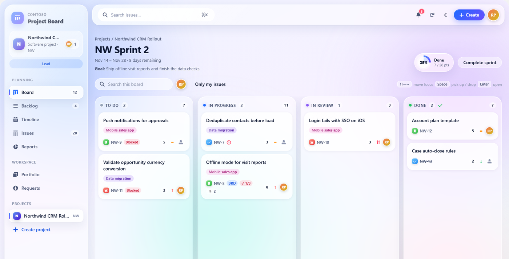 Board: active sprint, drag & drop, progress ring, BRD / test / file badges | 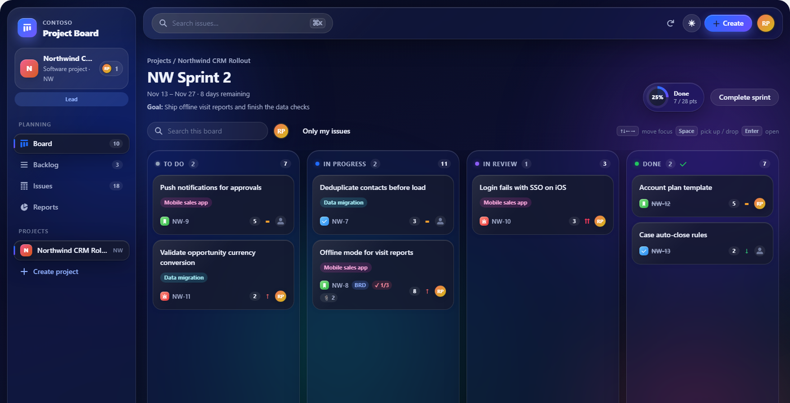 The same board in dark mode |
| 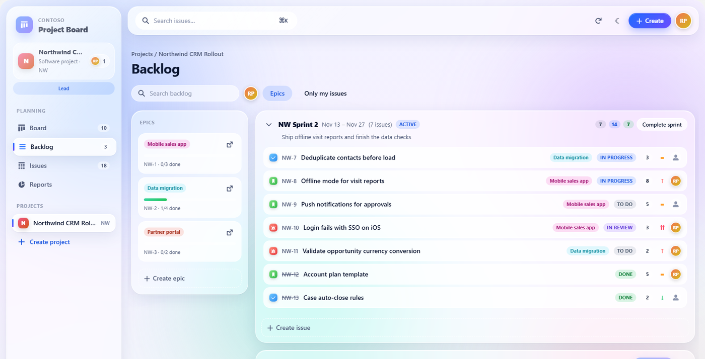 Backlog: sprints, epics panel with progress, quick create | 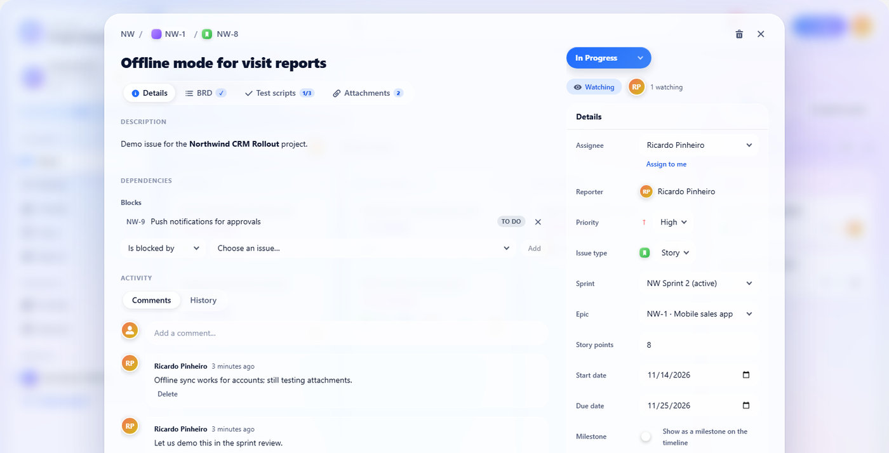 Issue: inline editing, comments, tabs for BRD / Test scripts / Attachments |
| 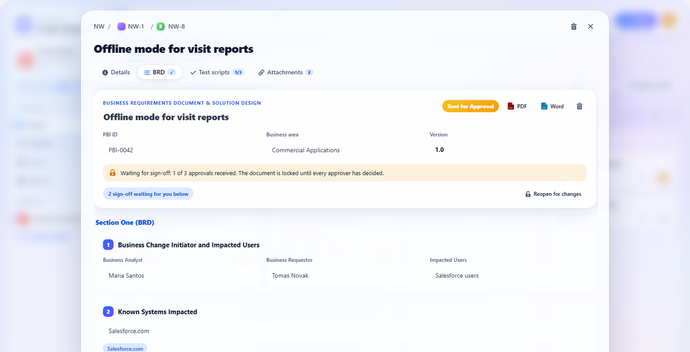 BRD out for approval: status, lock banner and the sign-offs waiting for you | 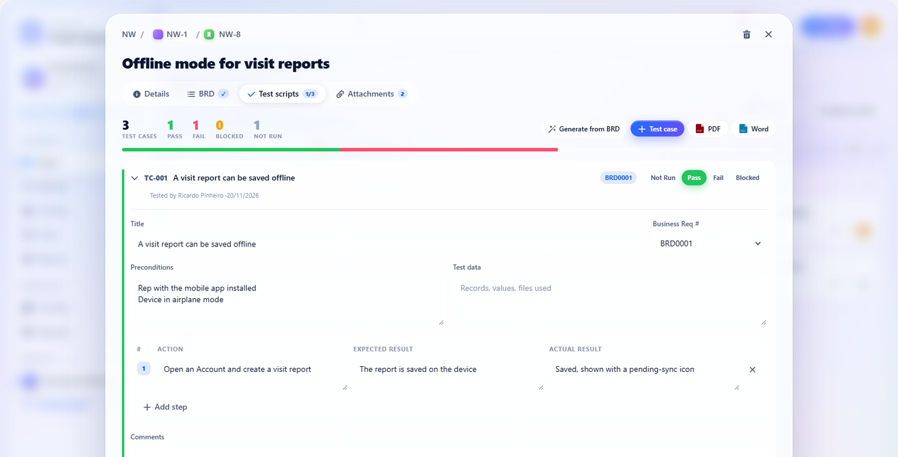 Test scripts: steps, Pass / Fail / Blocked, generated from the BRD |
| 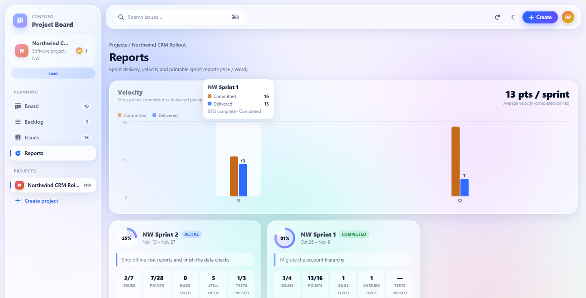 Reports: velocity (committed vs delivered) and sprint cards | 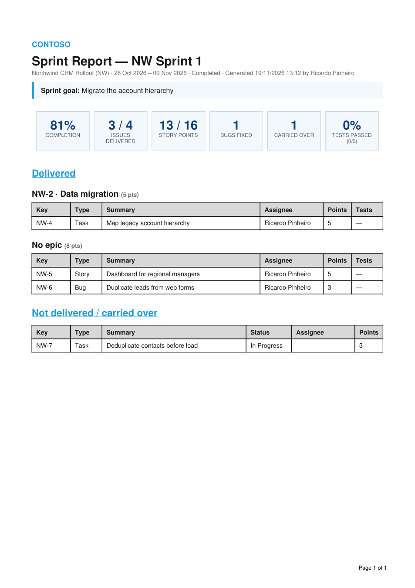 Sprint report exported to PDF |
| 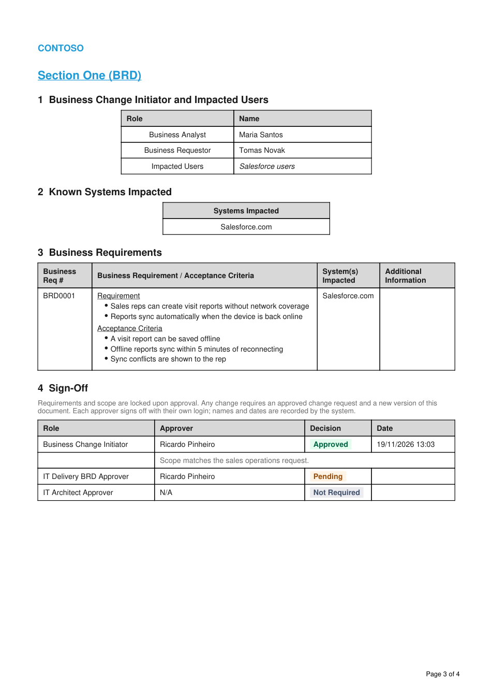 BRD exported to PDF with the recorded sign-off decisions (also available as Word) | 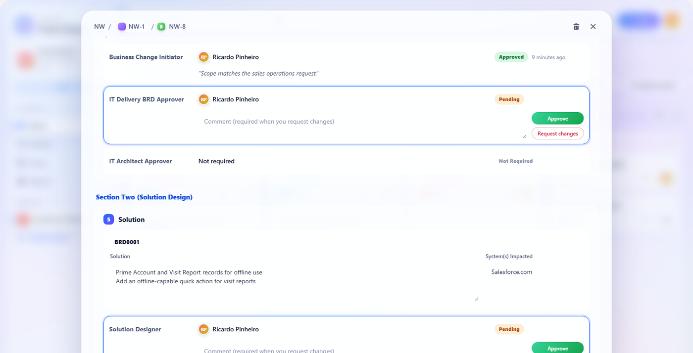 Sign-off: one approved with a comment, one waiting for a decision, one not required |
| 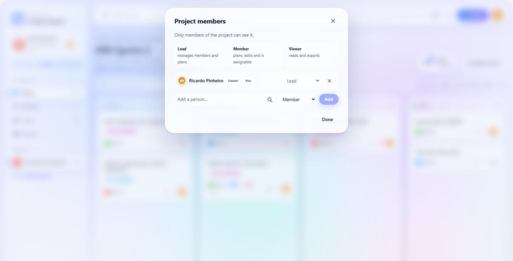 Project members and their roles | 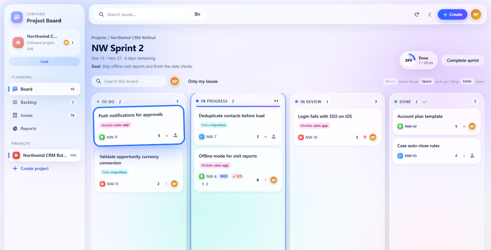 Keyboard move: the card is lifted with Space and the target column is highlighted |
| 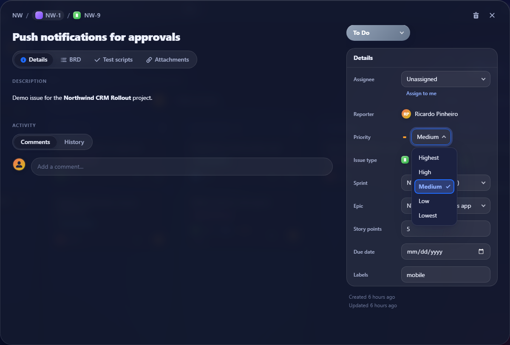 Picklists follow the design in both themes; the assignee list only offers project members | 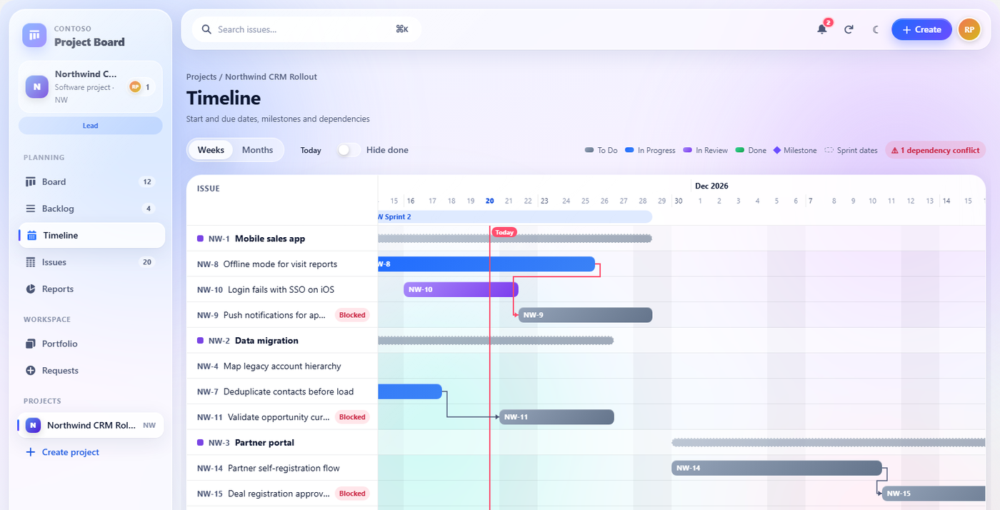 Timeline: bars by epic, today, dependency arrows (the red one is a conflict) |
| 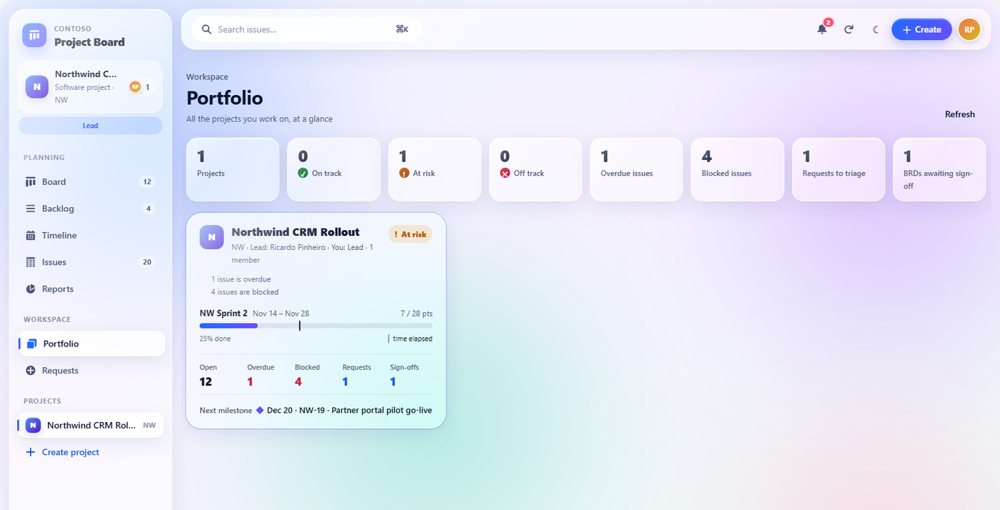 Portfolio: health with its reasons, sprint progress against time, next milestone | 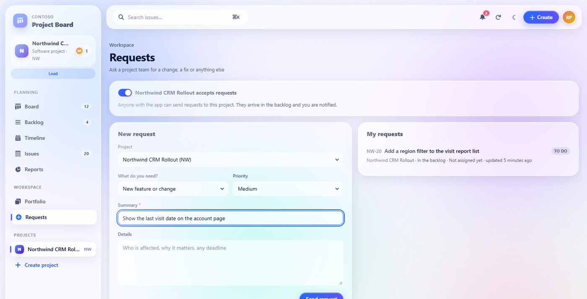 Requests: the form, My requests and the Lead's switch |
| 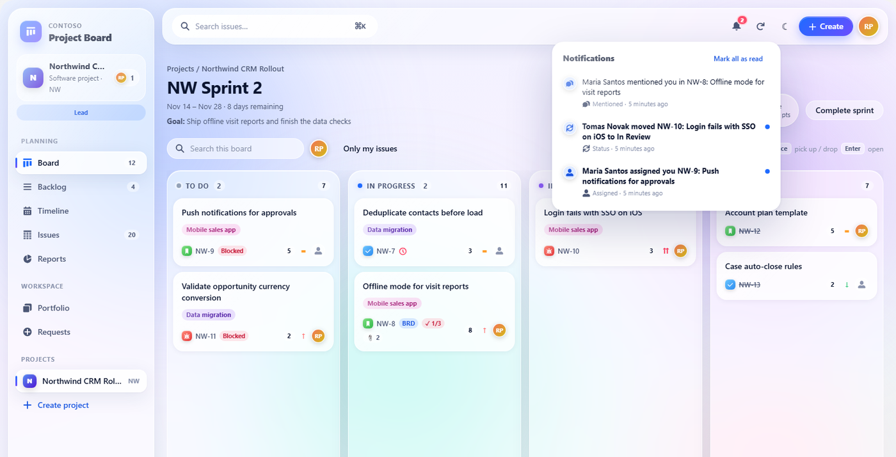 Inbox: mentions, status changes and assignments | 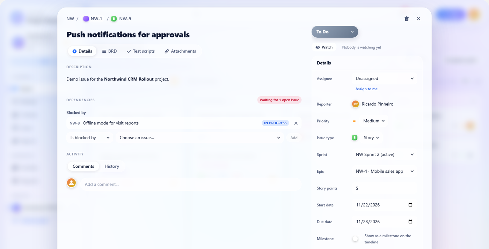 Issue: blocked by another issue, Watch, start date and milestone |

## Data model

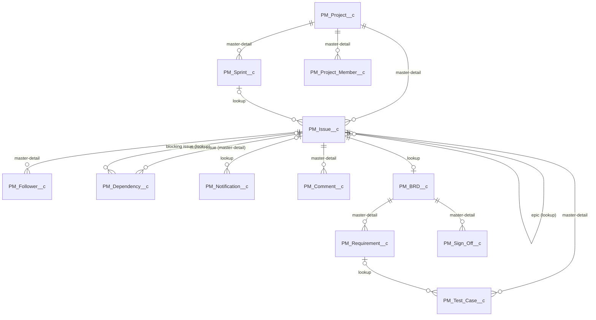

- **Issue keys** (`NW-12`) come from a counter on the project, incremented under `FOR UPDATE`, so concurrent creates never get the same key.
- **Ranks are fractional** (`Rank__c`, 6 decimals). A drag & drop computes the midpoint between the neighbours, so a move updates one record instead of re-ranking the column.
- **The BRD is linked to the issue by lookup.** Its requirements are master-detail children of the BRD, and Project → Issue → BRD → Requirement would exceed the three master-detail levels the platform allows.
- **Sprint snapshots.** Starting a sprint stores the committed issues and points. Completing it stores the carried-over issues as JSON. The sprint report compares committed vs delivered even after open work has left the sprint.
- **Members** (`PM_Project_Member__c`) hold the user and the role. A unique key (project + user) stops duplicates.
- **Sign-offs** (`PM_Sign_Off__c`) are one row per role: approver (a user lookup), status, decision date and comment. They replace free-text name and date fields.
- **Followers** (`PM_Follower__c`) and **dependencies** (`PM_Dependency__c`) follow their issue's sharing. A unique key stops duplicates.
- **Notifications** (`PM_Notification__c`) are **Private** and owned by the recipient, so each person only sees their own inbox, administrators included.
- **Issues** have a start date, a milestone flag, and `Requested_By__c` when they came in through the request form. Projects have `Accepts_Requests__c`.
- **Files** are standard Salesforce Files (`ContentDocumentLink`) on the issue, the BRD (solution screenshots, embedded in the PDF) and each test case (evidence).

## Apex

| Class | Responsibility |
| --- | --- |
| `ProjectBoardController` | Projects, members, board data (+ per-issue badge counters), issues, drag & drop moves, comments and history, sprints. |
| `ProjectDocsController` | BRD, requirements and the sign-off workflow, test cases (including generation from acceptance criteria), files. |
| `ProjectExportController` | View models for the three Visualforce exports. The same figures as the Reports view. |
| `ProjectActivityController` | Followers, @mentions, the inbox, and who is notified of what (in the app and in the Salesforce bell). |
| `ProjectPlanController` | Dependencies (no loops), the request form, and the portfolio with its health rules. |
| `ProjectBoardSharing` | The only `without sharing` class: rebuilds the Apex managed shares of projects and BRDs, and does the few writes a user cannot do directly (see below). |
| `ProjectMemberTrigger`, `ProjectBrdTrigger` | Keep the shares in step when members change or a BRD is created. |

**Security model.**

- **Visibility comes from membership.** `PM_Project__c` and `PM_BRD__c` are **Private**. Sprints, issues, comments and test cases follow their project (Controlled by Parent). `ProjectBoardSharing` gives every member an Apex managed share with the row cause `Project_Member__c`: **Edit** for Leads and Members, **Read** for Viewers. Removing a member removes the share. The creator of a project becomes its first Lead.
- **User mode everywhere else.** Queries use `WITH USER_MODE` and DML uses `as user`. Before a write, the controllers also check the caller's role, so a Viewer cannot edit even through the API.
- **The system boundary is small.** `ProjectBoardSharing` writes the shares, records a sign-off decision (an approver may be a Viewer, who can only read the BRD), deletes the BRD of an issue that is being deleted, writes notifications for other people and follows for Viewers, and files a request from someone who is not a member. The controllers check who is calling before they use it.
- **Sign-off rules are enforced on the server.** Only the named approver can decide, a request for changes needs a comment, and a BRD can only be edited while it is Draft or Changes Requested.
- **Permission sets.** `Project_Board_User` grants the objects, fields, classes, pages and tab, without View All / Modify All. `Project_Board_Admin` adds View All and Modify All on the module's objects, for administrators who must see every project.

Field updates sent by the browser go through a whitelist per object, and values are converted to the field type on the server.

## Lightning Web Components

| Component | Role |
| --- | --- |
| `projectBoardApp` | Shell: sidebar, top bar, theme, routing, project / sprint dialogs. Defines the design tokens. |
| `projectBoardKanban`, `projectBoardBacklog`, `projectBoardTimeline`, `projectBoardIssueList`, `projectBoardReports` | The project views. The board and the backlog implement the keyboard moves. |
| `projectBoardPortfolio`, `projectBoardRequests` | The workspace views (all projects, and the request form). |
| `projectBoardInbox` | The bell and its notification panel (polls every minute). |
| `projectBoardPeoplePicker` | Search for people to add to a project, in the same design as the picklists. |
| `projectBoardIssueDetail` | Create form and issue modal with tabs. Read-only for Viewers; the assignee list only offers Leads and Members. |
| `projectBoardSelect` | Picklist in the glass design, used instead of the native `<select>` (whose open list is drawn by the operating system). Keyboard listbox; fires `change` from the host, so handlers read `event.target.value`. |
| `projectBoardBrd`, `projectBoardTestScripts`, `projectBoardAttachments` | Documentation tabs. `projectBoardBrd` also runs the sign-off workflow. |
| `projectBoardUtils` | Pure helpers (view model, ranks, dates, export / file URLs), covered by Jest. |
| `projectBoardStyles` | CSS-only module: the shared glass design system. |

**Design system.** The design tokens (`--jx-*`) are defined once on the root element for the light and the dark theme. Custom properties cross the shadow DOM, so every child component inherits them. Modals and controls do not rely on global SLDS classes, so the same components render correctly in Lightning Experience and in LWR sites (native shadow DOM). The velocity chart colours were checked for colour-blind separation and contrast in both themes.

## Configure

| To change | Where |
| --- | --- |
| Company name printed on exports | Custom Label `Project_Board_Brand` |
| Logo on exports | Upload an image as the Static Resource `Project_Board_Logo` |
| Brand / app name and logo in the UI | Properties of the `projectBoardApp` component (App Builder or Experience Builder) |
| Who can use it | Permission set `Project_Board_User`, then membership of each project (**Members** button in the sidebar) |
| Who sees every project | Permission set `Project_Board_Admin` |
| Sign-off roles | `SIGN_OFF_ROLES` in `ProjectDocsController` and the `Role__c` picklist of `PM_Sign_Off__c` |
| Sign-off notifications | Custom notification type `Project_Board_Sign_Off` |
| Other notifications in the Salesforce bell | Custom notification type `Project_Board_Activity` |
| Who is told what | `ProjectActivityController` (header comment) |
| Portfolio health thresholds | `LAG_AT_RISK` and `LAG_OFF_TRACK` in `ProjectPlanController` |
| Which projects take requests | The switch in **Requests** (Leads), or `Accepts_Requests__c` on the project |
| Default business area / systems of a new BRD | Constants at the top of `ProjectDocsController` |

## Install

```bash
sf project deploy start -o crm-wizards -d force-app -l RunLocalTests
sf org assign permset -o crm-wizards -n Project_Board_User
sf apex run -o crm-wizards -f scripts/apex/seed-project-board.apex
```

Open the **Project Board** tab from the App Launcher. The seed makes you the Lead of the demo project and leaves its BRD out for approval, with one sign-off already approved. It also gives the issues dates, a milestone and dependencies (one of them a conflict), files a request, and adds three sample notifications so the inbox is not empty in a one-person org.

Give other users `Project_Board_User` and add them to a project with the **Members** button. Users who must see every project also get `Project_Board_Admin`.

### Optional: full-screen portal (Experience Cloud)

1. Create a **Build Your Own (LWR)** site: `sf community create --name "Projects" --template-name "Build Your Own (LWR)" --url-path-prefix projects`.
2. In Experience Builder, drop **Project Board** on the Home page and tick **Full screen**.
3. In Administration → Members, add the permission set `Project_Board_User`, allow internal users to log in, and publish.

In the portal, exports open from the site's Visualforce path (`/<prefix>vforcesite/apex/...`) and files from `/<prefix>/sfsites/c/...`; `projectBoardUtils` builds both URLs automatically.

## Demo script (10 minutes)

1. **Board.** Open *Northwind CRM Rollout*. Drag *Login fails with SSO on iOS* from In Review to Done and watch the progress ring move. Make the same move from the keyboard: Tab to a card, Space, Right arrow, Space. Filter by a person, then switch to dark mode.
2. **Members.** Open **Members** in the sidebar. Add a person as Viewer: for them, the issue modal opens read-only.
3. **Backlog.** Drag *Consent capture on contact forms* into the active sprint. Click the *Data migration* epic to filter.
4. **Issue.** Open *Offline mode for visit reports*:
   - **BRD:** numbered requirements and acceptance criteria, solution design. The document is out for approval and locked. Approve the pending sign-off, or request changes with a comment, then export it to PDF to show the recorded decisions.
   - **Test scripts:** one Pass, one Fail, one Not Run. **Generate from BRD** skips criteria that already have a test case. Export to Word.
   - **Attachments:** drop a file.
5. **Timeline.** One red arrow: *Push notifications* starts before *Offline mode* is due. Open it from the left column, move its start date and the conflict goes away.
6. **Requests and inbox.** Send a request from **Requests**, then find it in the backlog with the Request badge. Open the bell: a mention, a status change and an assignment.
7. **Portfolio.** The project is *At risk*: the reasons say why (one overdue issue, blocked work).
8. **Reports.** Velocity chart for sprints 1 and 2. Download the PDF report of *NW Sprint 1*: delivered by epic, carried over, test results.

## Tests

- **Apex:** `ProjectBoardControllerTest` and `ProjectDocsControllerTest` cover the lifecycle (projects, issues, moves, sprints, comments, BRD, test cases, files, the three exports) and the validation errors. They run as a new user with the permission set, so user-mode access is tested too.
- **Collaboration:** `ProjectCollaborationTest` covers followers, mentions (longest name first) and the inbox, dependencies (loops, other projects, Viewers), requests from a non-member, the portfolio health and the people search.
- **Access:** `ProjectBoardAccessTest` runs as three Standard User profile users (a Lead, a Member and an outsider). It checks that outsiders do not see the project, that roles limit what each user can do, the last-Lead rule, and the whole sign-off flow (lock, decision by the named approver only, comment on a request for changes, reopen to version 1.1).
- **Jest:** `projectBoardUtils` (ranks, view model, dependencies, URLs, helpers) and `projectBoardSelect` (keyboard, change event, Escape, type-ahead).
