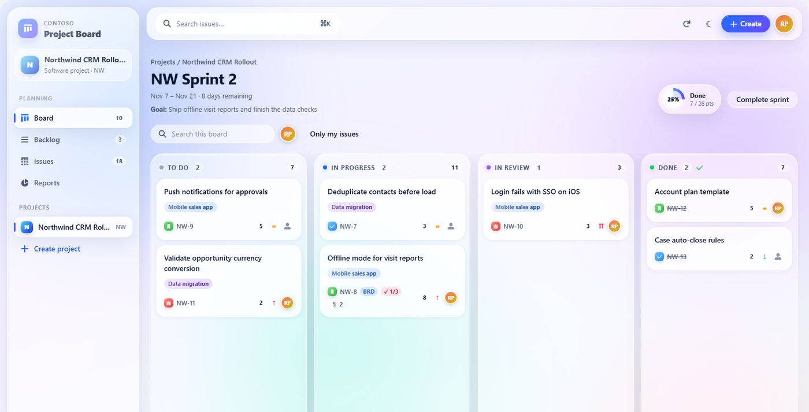
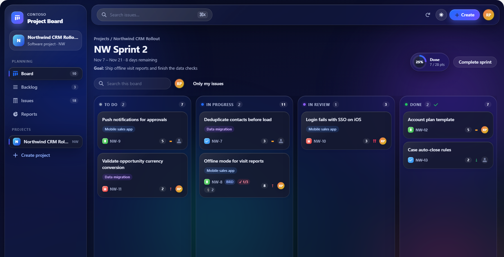
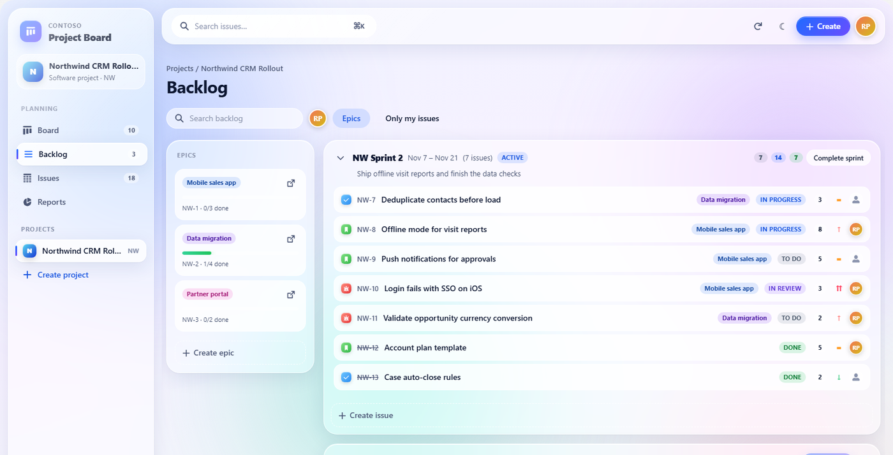
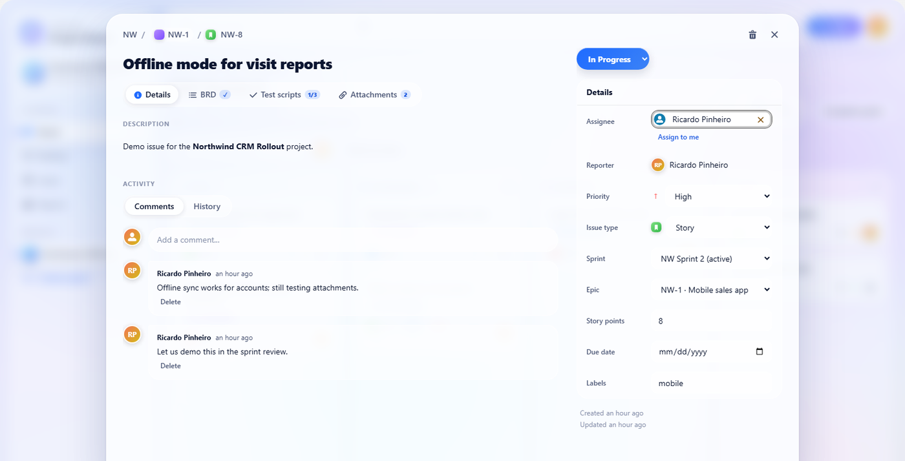
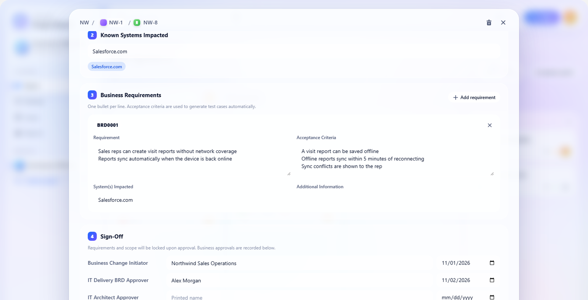
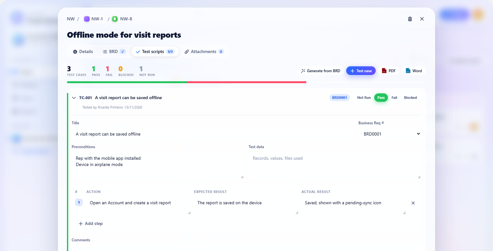
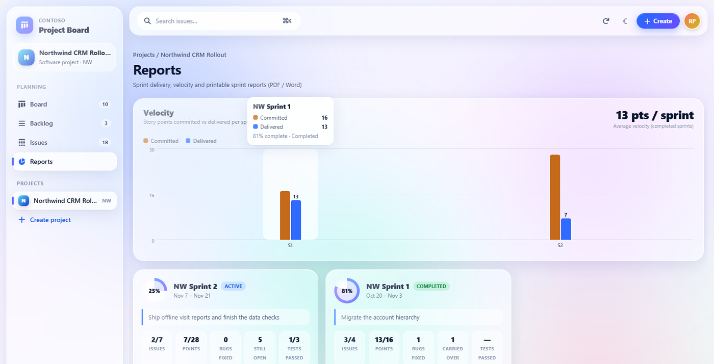
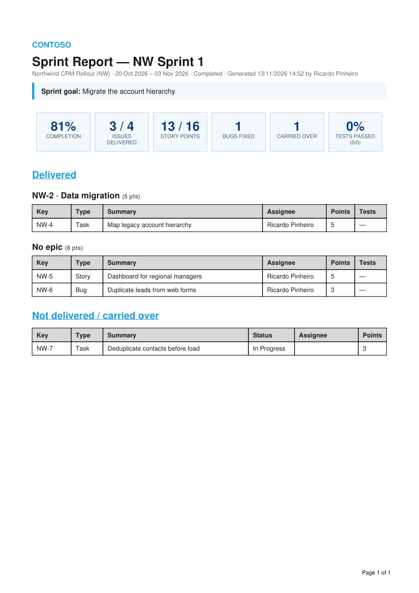
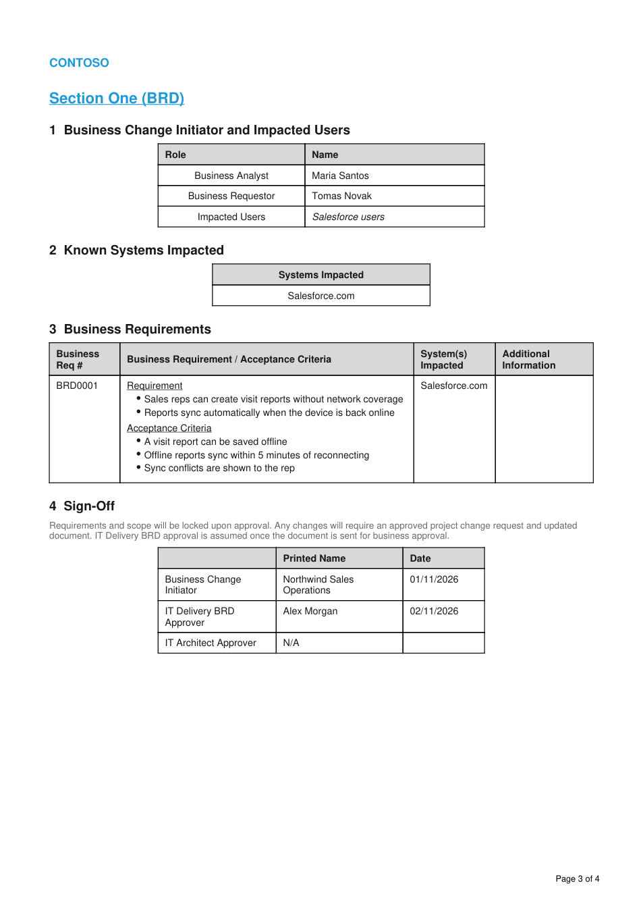
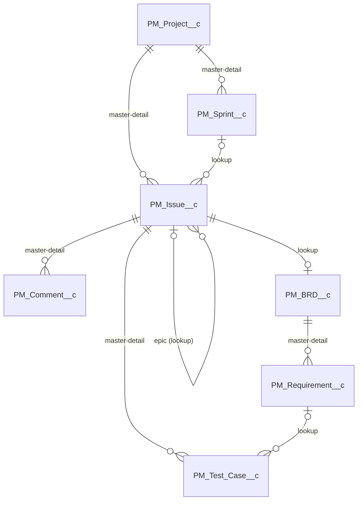

# Project Board

A Scrum-style project management app built entirely on Salesforce: Kanban board, backlog with sprints and epics, issue tracking, BRD & solution design documents, UAT test scripts, file attachments and printable sprint reports. It runs as a Lightning tab or as a full-screen Experience Cloud (LWR) portal, with a light / dark "liquid glass" UI.

It is built for teams that deliver Salesforce changes: the requirement, its solution design, its test evidence and the sprint it shipped in stay linked in one place, and every document exports to PDF or Word.

## Features

| Area | What it does |
| --- | --- |
| **Board** | Kanban of the active sprint (To Do / In Progress / In Review / Done). Drag & drop between and within columns, quick filters (search, people, only mine), sprint progress ring, badges for attachments, BRD and test results. With no active sprint it shows all open work (Kanban mode). |
| **Backlog** | Sprint sections and the backlog, drag & drop between them, inline quick create, epics panel with progress (click to filter), start / complete / delete sprint. Completing a sprint moves open work to the backlog or the next sprint. |
| **Issues** | Sortable, filterable list of every issue. |
| **Issue detail** | Inline editing of every field, rich-text description, comments, field history, epic children. Tabs for **BRD**, **Test scripts** and **Attachments**. |
| **BRD & Solution Design** | One document per issue, following a classic BRD template: initiator and impacted users, systems impacted, numbered business requirements (requirement + acceptance criteria), sign-off, and per-requirement solution design with screenshots. Pre-filled from the issue. |
| **Test scripts** | UAT test cases with steps (action / expected / actual), Pass / Fail / Blocked / Not Run, tester and date captured automatically, evidence files. **Generate from BRD** creates one test case per acceptance criterion. |
| **Reports** | Velocity chart (committed vs delivered points) and one card per sprint with completion, points, bugs fixed, carry-over and test pass rate. |
| **Exports** | BRD, test scripts and sprint report as **PDF** (Visualforce `renderAs="pdf"`) or **Word** (`application/msword`). |

## Screenshots

Captured in a Developer Edition org with `scripts/apex/seed-project-board.apex` (fictitious data).

| | |
| --- | --- |
|  Board: active sprint, drag & drop, progress ring, BRD / test / file badges |  The same board in dark mode |
|  Backlog: sprints, epics panel with progress, quick create |  Issue: inline editing, comments, tabs for BRD / Test scripts / Attachments |
|  BRD: numbered requirements and acceptance criteria, sign-off |  Test scripts: steps, Pass / Fail / Blocked, generated from the BRD |
|  Reports: velocity (committed vs delivered) and sprint cards |  Sprint report exported to PDF |
|  BRD exported to PDF (also available as Word) | |

## Data model



- **Issue keys** (`NW-12`) come from a counter on the project, incremented under `FOR UPDATE`, so concurrent creates never get the same key.
- **Ranks are fractional** (`Rank__c`, 6 decimals). A drag & drop computes the midpoint between the neighbours, so a move updates one record instead of re-ranking the column.
- **The BRD is linked to the issue by lookup.** Its requirements are master-detail children of the BRD, and Project → Issue → BRD → Requirement would exceed the three master-detail levels the platform allows.
- **Sprint snapshots.** Starting a sprint stores the committed issues and points. Completing it stores the carried-over issues as JSON. The sprint report compares committed vs delivered even after open work has left the sprint.
- **Files** are standard Salesforce Files (`ContentDocumentLink`) on the issue, the BRD (solution screenshots, embedded in the PDF) and each test case (evidence).

## Apex

| Class | Responsibility |
| --- | --- |
| `ProjectBoardController` | Projects, board data (+ per-issue badge counters), issues, drag & drop moves, comments and history, sprints. |
| `ProjectDocsController` | BRD and requirements, test cases (including generation from acceptance criteria), files. |
| `ProjectExportController` | View models for the three Visualforce exports. The same figures as the Reports view. |

**Security model.** Unlike the wizards, this module writes **in user mode** (`WITH USER_MODE`, `insert as user`, `update as user`). Access is granted by the permission set `Project_Board_User` (objects, fields, Apex classes, Visualforce pages and the tab). Field updates sent by the browser go through a whitelist per object, and values are converted to the field type on the server.

## Lightning Web Components

| Component | Role |
| --- | --- |
| `projectBoardApp` | Shell: sidebar, top bar, theme, routing, project / sprint dialogs. Defines the design tokens. |
| `projectBoardKanban`, `projectBoardBacklog`, `projectBoardIssueList`, `projectBoardReports` | The four views. |
| `projectBoardIssueDetail` | Create form and issue modal with tabs. |
| `projectBoardBrd`, `projectBoardTestScripts`, `projectBoardAttachments` | Documentation tabs. |
| `projectBoardUtils` | Pure helpers (view model, ranks, dates, export / file URLs), covered by Jest. |
| `projectBoardStyles` | CSS-only module: the shared glass design system. |

**Design system.** The design tokens (`--jx-*`) are defined once on the root element for the light and the dark theme. Custom properties cross the shadow DOM, so every child component inherits them. Modals and controls do not rely on global SLDS classes, so the same components render correctly in Lightning Experience and in LWR sites (native shadow DOM). The velocity chart colours were checked for colour-blind separation and contrast in both themes.

## Configure

| To change | Where |
| --- | --- |
| Company name printed on exports | Custom Label `Project_Board_Brand` |
| Logo on exports | Upload an image as the Static Resource `Project_Board_Logo` |
| Brand / app name and logo in the UI | Properties of the `projectBoardApp` component (App Builder or Experience Builder) |
| Who can use it | Permission set `Project_Board_User` |
| Default business area / systems of a new BRD | Constants at the top of `ProjectDocsController` |

## Install

```bash
sf project deploy start -o crm-wizards -d force-app -l RunLocalTests
sf org assign permset -o crm-wizards -n Project_Board_User
sf apex run -o crm-wizards -f scripts/apex/seed-project-board.apex
```

Open the **Project Board** tab from the App Launcher.

### Optional: full-screen portal (Experience Cloud)

1. Create a **Build Your Own (LWR)** site: `sf community create --name "Projects" --template-name "Build Your Own (LWR)" --url-path-prefix projects`.
2. In Experience Builder, drop **Project Board** on the Home page and tick **Full screen**.
3. In Administration → Members, add the permission set `Project_Board_User`, allow internal users to log in, and publish.

In the portal, exports open from the site's Visualforce path (`/<prefix>vforcesite/apex/...`) and files from `/<prefix>/sfsites/c/...`; `projectBoardUtils` builds both URLs automatically.

## Demo script (5 minutes)

1. **Board.** Open *Northwind CRM Rollout*. Drag *Login fails with SSO on iOS* from In Review to Done and watch the progress ring move. Filter by a person, then switch to dark mode.
2. **Backlog.** Drag *Consent capture on contact forms* into the active sprint. Click the *Data migration* epic to filter.
3. **Issue.** Open *Offline mode for visit reports*:
   - **BRD:** numbered requirements and acceptance criteria, sign-off, solution design. Export it to PDF.
   - **Test scripts:** one Pass, one Fail, one Not Run. **Generate from BRD** skips criteria that already have a test case. Export to Word.
   - **Attachments:** drop a file.
4. **Reports.** Velocity chart for sprints 1 and 2. Download the PDF report of *NW Sprint 1*: delivered by epic, carried over, test results.

## Tests

- **Apex:** `ProjectBoardControllerTest` and `ProjectDocsControllerTest` cover the lifecycle (projects, issues, moves, sprints, comments, BRD, test cases, files, the three exports) and the validation errors. They run as a new user with the permission set, so user-mode access is tested too.
- **Jest:** `projectBoardUtils` (ranks, view model, URLs, helpers).
